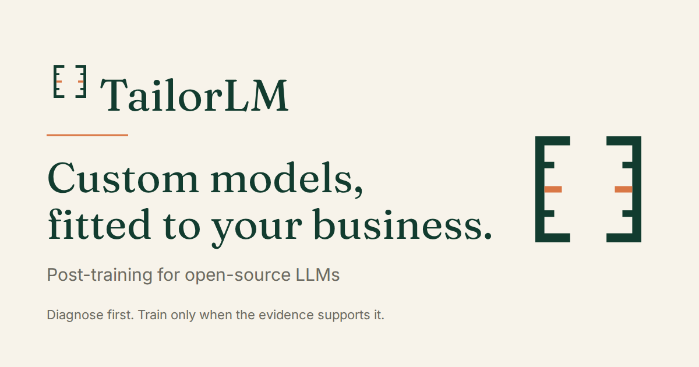

# TailorLM

[](https://github.com/tailorlm/tailorlm/actions/workflows/ci.yml)

**Custom models, fitted to your business.**



TailorLM is a post-training studio for open-source LLMs. Start with a free problem review (`$0`), lock a baseline test set (`$2` limited queued, reg. `$15`), and settle fees at the end on delivery/acceptance — only training when the evidence justifies it. Acceptance is measured on a held-out test set — not on a loss curve.

[Website](https://tailorlm.mcocdaa.com/) · [中文站](https://tailorlm.mcocdaa.com/zh/) · [中文](#中文) · [Services](#services) · [How we work](#how-we-work) · [Contact](#contact)

## Services

| | |
| --- | --- |
| **Free problem review (`$0`)** | Review 3 real failure examples over email to confirm training vs. Prompt/RAG fit and rough cost. |
| **Baseline & eval pack (`$2` limited)** | Turn raw failures into a 30–50 case held-out test set, scoring rubric, and measured baseline score (credited toward full delivery within 30d). |
| **LoRA experiment (`$15` limited)** | Validate the training signal on a small leak-checked dataset before scaling. |
| **Full delivery (`$45+` limited)** | Adapter or merged model, held-out evaluation & general regression report, inference example, and deployment notes. |

## How we work

1. **Consult free.** Send 3 real failures by email, check data rights, and agree on the metric with `$0` upfront service deposit.
2. **Baseline.** Measure the current model on a fixed held-out test set.
3. **Experiment.** Start with a small, high-quality sample; scale only if there is a measurable signal.
4. **Deliver & settle.** Release weights/model, evaluation report, failure cases, and known limitations at final settlement.

We do not sell GPU time (cloud compute runs on your account or at cost with 0% markup), and we do not promise “train until satisfied.”

## This repository

Source of the TailorLM website: Astro 7, static output, no UI framework. English pages live at the root (`/`); Chinese pages live under `/zh/`. Legacy `/en/*` paths 301-redirect to `/`.

```bash
pnpm install
pnpm dev
pnpm build
```

Deployment: see [`deploy/README.md`](deploy/README.md).

## 中文

**量体裁模。** TailorLM 为有明确任务和数据的团队做开源 LLM 后训练：先免费咨询看问题，零预付定金定好 SOW 与测试集，最后结尾交付验收时付款。

- **问题评估（免费 `¥0`）**：看 3 个真实失败例子，判断是否真的需要训练。
- **基线与评测包（限时 `¥10` / 原价 `¥100`）**：把问题变成 30–50 题可复现评测集与基线分数（30 天内升档可抵扣）。
- **LoRA 小试验（限时 `¥99` / 原价 `¥299`）**：小样本防泄漏验证方向，有信号再扩大。
- **完整交付（限时 `¥299+` / 原价 `¥999+`）**：模型或 adapter、评测与通用回归报告、推理示例和部署说明。

不卖 GPU 租赁（0% 管理费实报实销或客户自备云算力），不承诺“训到满意”。

## Contact

[tailorlm.mcocdaa.com](https://tailorlm.mcocdaa.com) · contact@mcocdaa.com · [github.com/tailorlm](https://github.com/tailorlm)
